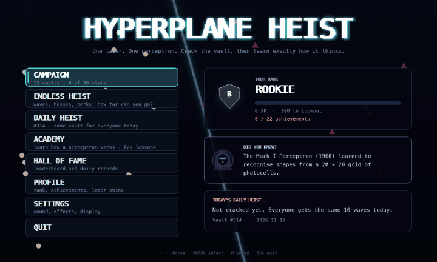

# Hyperplane Heist

A heist game about a single perceptron. The vault's whole security system is one artificial neuron, and its decision boundary is a laser across the floor:

```
w₁·x₁ + w₂·x₂ + b = 0
```

Put every Authorized Bot on the laser's SAFE side and every Intruder Drone on its ALARM side, then lock it in. Get it wrong and the perceptron fights back with one step of its learning rule, and the laser snaps somewhere new.



## Play in your browser

**[▶ Play Hyperplane Heist](https://rishikeshwalhekar49-lab.github.io/perceptron/)**. There is nothing to install.

- Click the page once to start. Browsers only allow sound after a click.
- The first visit downloads about 23 MB (Python, compiled to WebAssembly), so it takes a few seconds. Later visits load from your browser's cache.
- Play on a computer. Every screen works with the keyboard, or with the mouse alone; phones haven't been tested.
- Your progress is saved in the browser you play in.

## Run it on your computer

It is the same game, and on your computer it can also run full screen (F11).

1. **Get the code.** On this page, click **Code → Download ZIP** and unzip it, or run `git clone https://github.com/rishikeshwalhekar49-lab/perceptron.git`.
2. **Install Python 3.9 or newer** from [python.org](https://www.python.org/downloads/). On Windows, tick **Add python.exe to PATH** in the installer.
3. **Open a terminal in the game's folder** (the one with `hyperplane_heist.py` in it) and run the three lines for your system. The first two set up a private Python environment in `.venv` and install pygame there, so nothing else on your computer changes. To play again later, run only the last line.

Windows (Command Prompt or PowerShell):

```
py -m venv .venv
.venv\Scripts\python -m pip install -r requirements.txt
.venv\Scripts\python hyperplane_heist.py
```

macOS and Linux:

```bash
python3 -m venv .venv
.venv/bin/python -m pip install -r requirements.txt
.venv/bin/python hyperplane_heist.py
```

- pygame has no build for Python 3.14 or newer yet, so on those versions `requirements.txt` installs [pygame-ce](https://pypi.org/project/pygame-ce/), a compatible fork, instead.
- If Windows says `py` is not found, type `python` instead.
- On Debian or Ubuntu, run `sudo apt install python3-venv` first if the first line fails.

## Modes

- **Campaign:** 12 hand-made vaults, each teaching one idea (bias, rotation, flipping sides, margin, patrols, a spinning floor, an AND gate, noisy data), with up to 3 stars each. The last vault is XOR: you win it by proving that no line can.
- **Endless Heist:** generated waves with a timer, combos and shields. Expect moving vaults, imposter drones, a boss every 5th wave and a perk after each boss.
- **Daily Heist:** the same 10 waves for everyone on the same day.
- **Academy:** 8 hands-on lessons on how a perceptron works, with every formula computed live from sliders, and a quiz with fresh numbers each time.

There are ranks, 22 achievements, 6 laser colours to unlock and a local top-10 leaderboard. Sound and music are generated in code, so there are no audio files.

## Controls

| Key | Action |
| --- | --- |
| ← → | change w₁ (tilts the laser) |
| ↓ ↑ | change w₂ (tilts the laser) |
| W / S, SPACE | change the bias b (slides the laser); SHIFT + SPACE lowers b |
| Q / E, mouse wheel | turn the laser |
| F, right-click | flip: same line, SAFE and ALARM swap |
| Mouse drag | drag an end to aim, the beam to slide, or the floor to draw a new laser |
| ENTER | lock in |
| X | declare that no straight line can split the vault |
| T | Auto-Trainer (an Endless perk) |
| M | sound on / off |
| ESC | pause / back |

The key hints along the bottom of the screen are buttons too, so the whole game can be played with a mouse.

## Notes

- The desktop game saves to `~/.hyperplane_heist/save.json`; set `HYPERPLANE_HEIST_SAVE` to move it. The browser version saves in the browser's local storage.
- Set `HYPERPLANE_HEIST_AUDIO=0` to play without opening any audio device.
- `selftest.py` runs a headless self-test (no window) that never touches your save file. It passes on macOS with Python 3.9, 3.11 and 3.14. Windows and Linux run the same code but haven't been tested yet.
- The perceptron itself is the `Perceptron` class in `heist/core.py`.
- The fonts in `heist/fonts/` are DejaVu Sans Mono, under the license in `heist/fonts/LICENSE_DEJAVU`.

## Build the browser version

```bash
.venv/bin/python -m pip install pygbag==0.9.3
.venv/bin/python tools/build_web.py           # writes the site to build/web/
.venv/bin/python tools/build_web.py --serve   # or builds it and serves it at http://localhost:8000
```

The page, with its loading screen and link-preview tags, is `tools/web/index.tmpl`; the build also draws `preview.png`, the card that shows up when the link is shared. `build/web/` is a static site for GitHub Pages, itch.io or any web server. The page loads Python and pygame from pygbag's CDN, so players need to be online. Test it with `--serve` rather than a plain web server: when the page is served from localhost, it looks for the runtime on pygbag's own server at port 8000.
